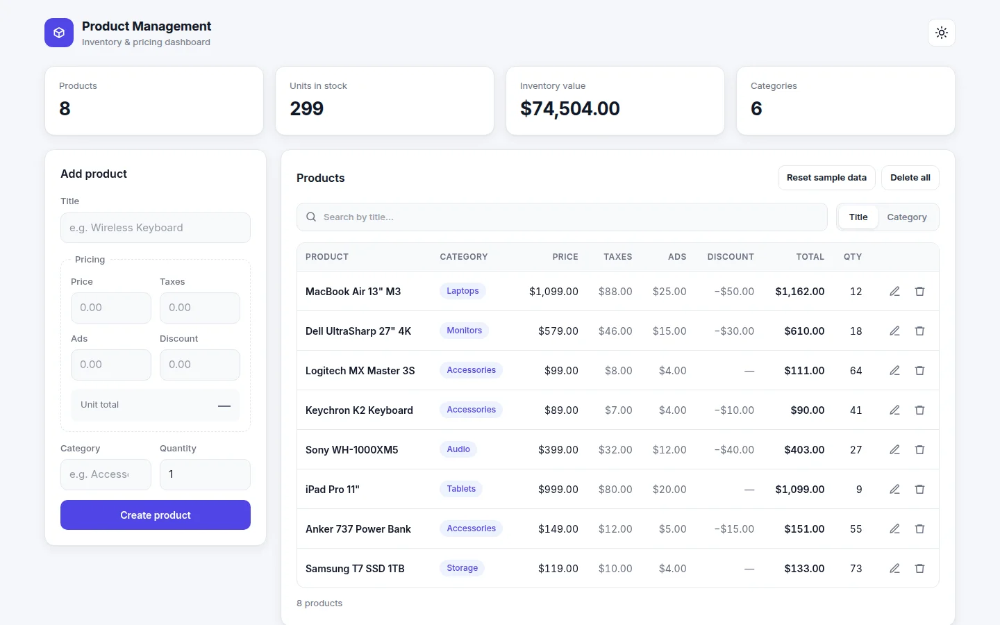
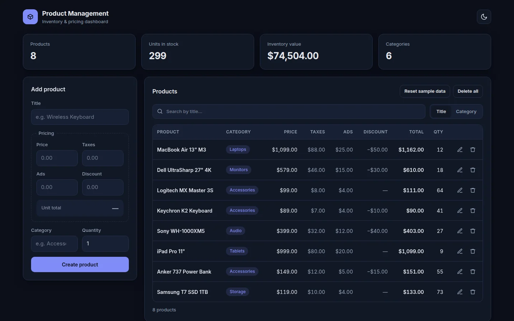
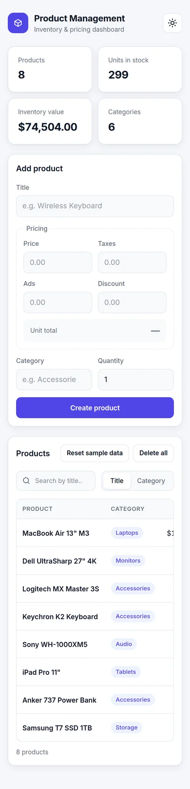

# Product Management System

A framework-free inventory and pricing dashboard built with **vanilla HTML, CSS and JavaScript**. Create, edit, search and price products; everything persists in the browser with `localStorage`.

**[Live demo →](https://montaser-hub.github.io/product-management-system/)**



<details>
<summary>Dark theme &amp; mobile</summary>





</details>

## Features

- **Full CRUD**: create, edit, and delete products, or clear them all (with a confirmation step)
- **Live pricing**: the unit total (`price + taxes + ads − discount`) updates as you type, with validation that stops a discount exceeding the price
- **Inventory stats**: product count, units in stock, total inventory value and number of categories, all recalculated on every change
- **Search**: filter by title or category with a debounced search box and a segmented toggle
- **Category suggestions**: the category field autocompletes from categories you've already used
- **Light/dark theme**: follows your system setting on first visit, then remembers your choice, with no flash of the wrong theme on load
- **Sample data**: the first visit loads a realistic sample inventory, and it can be restored at any time
- **Responsive**: a two-column dashboard on desktop and a stacked layout on mobile, where the table scrolls on its own
- **Accessible**: every field has a label, validation errors are announced to screen readers, and the whole app works from the keyboard with visible focus

## Implementation notes

| Concern | Approach |
| --- | --- |
| Row identity | Each product has a stable `id` (`crypto.randomUUID`), so edit and delete act on the right product even while the list is filtered |
| XSS safety | All user input is HTML-escaped before rendering |
| Events | A single delegated click listener on the table body instead of inline `onclick` handlers |
| Data model | One record per product with a `quantity` field; totals are derived, never stored |
| Storage | Namespaced `localStorage` keys, wrapped so the app still runs when storage is unavailable (e.g. some private-browsing modes) |
| Formatting | `Intl.NumberFormat` for currency and numbers |

## Run locally

No build step or dependencies are needed:

```bash
git clone https://github.com/montaser-hub/product-management-system.git
cd product-management-system
python3 -m http.server 8000   # or: npx serve
```

Then open http://localhost:8000.

## Project structure

```
index.html   Markup and the inline theme bootstrap
styles.css   Design tokens (light/dark) and the responsive layout
main.js      State, validation, rendering and persistence
docs/        README screenshots
```

## Possible extensions

- Sync to a backend (REST API or Firebase) for multi-device use
- Sortable columns and pagination for large inventories
- CSV import and export

## License

[MIT](LICENSE) © Montaser Ismail
